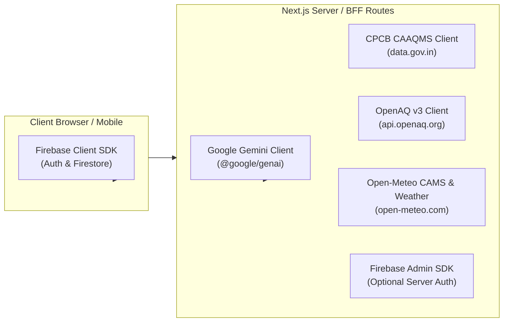

# API Dependency & Feasibility Matrix

> **Document ID:** HS-DEP-001  
> **Status:** Fully Verified & Production Feasible  
> **Target Environment:** Node.js / Next.js Serverless & Client Runtimes

---

## 1. External Service & API Inventory

Every external technical dependency is audited for accessibility, licensing, authentication, latency, rate limits, and fallback strategies.



---

## 2. In-Depth Dependency Specifications

| Service / Dependency | Provider / Spec | Host / Endpoint | Auth & Credentials | Rate Limit / Quota | Licensing / Cost | Fallback / Failover Mechanism |
| :--- | :--- | :--- | :--- | :--- | :--- | :--- |
| **CPCB CAAQMS (OGD India)** | Central Pollution Control Board (MoEFCC) | `https://api.data.gov.in/resource/3b01bcb8-0b14-4abf-b6f2-c1bfd384ba69` | `api-key` query param (Server-side secret: `DATA_GOV_IN_API_KEY`) | 1,000 records/call, 10,000 req/day per key | Government Open Data License (GODL) India; Free | Failover to **OpenAQ v3** within 3,000 ms if timeout or HTTP 5xx occurs |
| **OpenAQ v3 API** | OpenAQ 501(c)(3) Environmental Data | `https://api.openaq.org/v3/locations?countries_id=9` | `X-API-Key` header (Server-side secret: `OPENAQ_API_KEY`) | 60 req/min, 2,000 req/hour (Free Tier) | Open Database License (ODbL) / CC BY 4.0; Free | Failover to **WAQI raw measurement parser** or nearest validated station |
| **Open-Meteo Air Quality (CAMS Global)** | Copernicus Atmosphere Monitoring Service | `https://air-quality-api.open-meteo.com/v1/air-quality?domains=cams_global` | No key required (Public endpoint) | 600 req/min, 5,000 req/hour, 10,000 req/day | Creative Commons Attribution 4.0 (CC BY 4.0); Free non-commercial | Cache previous 12h forecast cycle (CAMS updates twice daily); UI renders `FORECAST_MODEL` badge |
| **Open-Meteo Weather API** | European Centre for Medium-Range Weather Forecasts (ECMWF) / DWD | `https://api.open-meteo.com/v1/forecast` | No key required (Public endpoint) | 600 req/min, 5,000 req/hour, 10,000 req/day | CC BY 4.0; Free non-commercial | Use cached hourly meteorological parameters for dispersion analysis |
| **Google Gemini API** | Google DeepMind / Google Cloud Vertex AI | `https://generativelanguage.googleapis.com` via `@google/genai` | API Key (Server-side secret: `GEMINI_API_KEY`) | Free tier: 15 RPM, 1,500 RPD; Pay-as-you-go: high throughput | Commercial Google Terms; Free tier eligible | Immediate transition to local **DeterministicRecommender** rule engine |
| **Firebase Authentication** | Google Cloud Firebase Identity Platform | Client SDK (`firebase/auth`) / `identitytoolkit.googleapis.com` | Firebase Config (`apiKey`, `authDomain`, `projectId`) | Unlimited email links; 50k MAU free tier | Google Cloud Terms of Service; Generous free tier | Client-side **Guest Mode** (ephemeral `sessionStorage`) requires zero auth |
| **Cloud Firestore** | Google Cloud NoSQL Realtime Database | Client SDK (`firebase/firestore`) with Security Rules | Firebase Config + Security Rules UID scoping | 50,000 reads/day, 20,000 writes/day free tier | Google Cloud Terms of Service; Free tier eligible | Ephemeral local storage for unauthenticated sessions |

---

## 3. Rate Limit Management & In-Memory Caching Topology

To prevent upstream quota exhaustion and guarantee sub-200ms user response times:

```
[ Incoming Request ]
        │
        ▼
[ Cache Check (Key: geohash_precision_6) ]
   ├── Cache Hit (Age < 15 mins for observed, < 3 hours for forecast)
   │      └── Return cached snapshot immediately (0 external API calls)
   │
   └── Cache Miss / Stale
          │
          ├── Parallel Fetch:
          │     ├── CPCB CAAQMS (data.gov.in) [Timeout: 3000ms]
          │     │     └── If Fail: OpenAQ v3 [Timeout: 3000ms]
          │     ├── Open-Meteo CAMS Global [Timeout: 2500ms]
          │     └── Open-Meteo Weather [Timeout: 2000ms]
          │
          ├── CPCB Sufficiency & AQI Calculation Engine
          ├── Write to Cache (TTL: 15m observed, 3h forecast)
          └── Return fresh validated snapshot
```

---

## 4. Upstream Failure Modes & Resiliency Protocol

| Failure Scenario | Upstream Error Code | Detection Threshold | Automated Recovery Action | User-Facing Notice |
| :--- | :--- | :--- | :--- | :--- |
| **data.gov.in Down / Latency** | HTTP 500, 502, 503, ETIMEDOUT | Latency $> 3,000\text{ ms}$ or 2 consecutive 5xx | Switch station lookup to OpenAQ v3 Indian station repository | *"Live readings sourced from OpenAQ secondary monitor network."* |
| **OpenAQ Rate Limited** | HTTP 429 Too Many Requests | HTTP 429 header parsed | Fall back to cached station readings with `STALE` flag or WAQI raw parameters | *"Displaying cached station readings (observed X minutes ago)."* |
| **Gemini API Down / Throttled** | HTTP 429, 500, 503, or parse failure | Timeout $> 5,000\text{ ms}$ or Zod schema validation error | Invoke `DeterministicRecommender` with ground metrics and user constraints | *"Recommendations generated by HawaSaathi Expert Rules Engine."* (No disruption) |
| **Firebase Disconnected (Offline)** | Network error / client offline | Firestore SDK offline event | Firestore enables local IndexedDB caching automatically; local state preserved | *"Working offline. Changes will sync once reconnected."* |
| **Insufficient Station Pollutants** | Missing PM2.5/PM10 or $<3$ parameters | CPCB sufficiency check fails | Suppress overall AQI; render sub-indices with warning | *"Overall CPCB AQI unavailable (minimum 3 pollutants required including PM2.5/PM10)."* |
