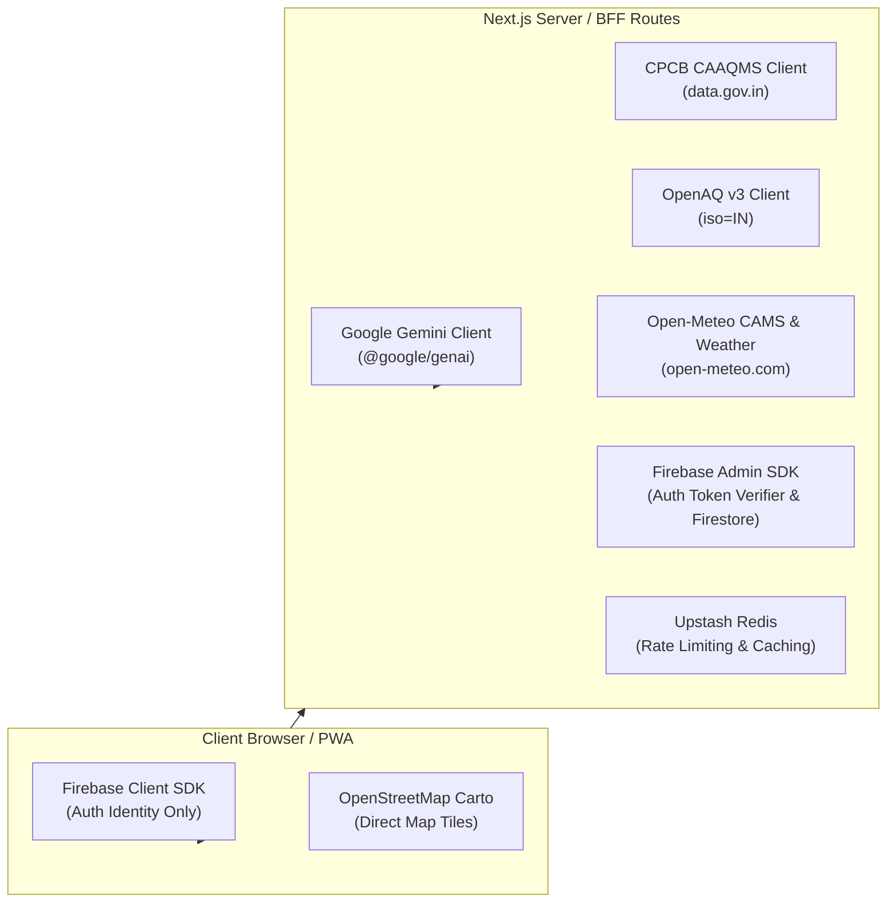

# API Dependency, Verification & Feasibility Matrix

> **Document ID:** HS-DEP-001  
> **Status:** Revised Baseline (Post-Audit)  
> **Target Environment:** Node.js / Next.js 15.x Serverless & Client Runtimes

---

## 1. External Service & API Inventory

Every external technical dependency is audited for access status, licensing, authentication, latency, rate limits, and fallback strategies based on actual live testing conducted on 2026-11-20.



---

## 2. In-Depth Dependency Specifications & Audit Statuses

| Service / Dependency | Provider / Spec | Endpoint / Resource | Verified Method & Evidence | Quotas & Limits | Licensing & Terms | Provider Audit Status | Fallback / Failover Mechanism |
| :--- | :--- | :--- | :--- | :--- | :--- | :--- | :--- |
| **CPCB CAAQMS (OGD India)** | Central Pollution Control Board (MoEFCC) | Resource `3b01bcb8-0b14-4abf-b6f2-c1bfd384ba69` | Live HTTP GET curl (2026-11-20T16:08:06 GMT): **HTTP 200 OK**<br>Total records: 4,046 across India. Fields: `min_value`, `max_value`, `avg_value`, `last_update` | 1,000 records/page; developer key recommended for prod | Government Open Data License (GODL) India; Free | **LIVE ACCESS VERIFIED** | Failover to OpenAQ v3 within 3,000 ms if timeout or HTTP 5xx occurs |
| **OpenAQ v3 API** | OpenAQ 501(c)(3) Environmental Data | `https://api.openaq.org/v3/locations?iso=IN` | Live HTTP GET curl (2026-11-20T16:09:51 GMT): **HTTP 401 Unauthorized** (`A valid API key must be provided in X-API-Key header`) | 60 req/min, 2,000 req/hr (Free Tier) | Open Database License (ODbL) / CC BY 4.0; Free | **DOCUMENTATION VERIFIED / ACCESS UNVERIFIED** *(Pending developer key)* | Failover to nearest cached station reading |
| **Open-Meteo Air Quality (CAMS Global)** | Copernicus Atmosphere Monitoring Service | `https://air-quality-api.open-meteo.com/v1/air-quality?domains=cams_global` | Live HTTP GET curl (2026-11-20T16:10:06 GMT): **HTTP 200 OK**<br>120 hourly time steps (5 full days) returned | 600 req/min, 5,000 req/hr, 10,000 req/day | Creative Commons Attribution 4.0 (CC BY 4.0); Free non-commercial | **LIVE ACCESS VERIFIED** *(Model forecast only)* | Cache previous 12h forecast cycle (CAMS updates twice daily); UI strictly labels `MODEL_FORECAST` |
| **Open-Meteo Weather API** | European Centre for Medium-Range Weather Forecasts (ECMWF) | `https://api.open-meteo.com/v1/forecast` | Documentation & parameter schema verified | 600 req/min, 5,000 req/hr, 10,000 req/day | CC BY 4.0; Free non-commercial | **DOCUMENTATION VERIFIED** | Use cached hourly meteorological parameters for dispersion analysis |
| **Google Gemini API** | Google DeepMind / Vertex AI | `generativelanguage.googleapis.com` via `@google/genai` | SDK contract verified; JSON schema mode specified | Free tier: 15 RPM, 1,500 RPD; Pay-as-you-go available | Commercial Google Terms; Free tier eligible | **DOCUMENTATION VERIFIED** | Immediate transition to local `DeterministicRecommender` rule engine on timeout ($>5000\text{ ms}$) or 5xx |
| **Firebase Authentication** | Google Cloud Firebase Identity Platform | Client SDK (`firebase/auth`) | Modular SDK contract verified for Google Sign-In & Email Link | Unlimited email links; 50k MAU free tier | Google Cloud Terms of Service | **DOCUMENTATION VERIFIED** | Client-side **Guest Mode** operates 100% locally in `sessionStorage` (zero dependency) |
| **Cloud Firestore** | Google Cloud NoSQL Realtime Database | Server Admin SDK (`firebase-admin/firestore`) | Server-side repository pattern; Client direct access denied | 50,000 reads/day, 20,000 writes/day free tier | Google Cloud Terms of Service | **DOCUMENTATION VERIFIED** | Local-only storage for unauthenticated sessions |
| **WAQI (aqicn.org)** | World Air Quality Index Project | `https://api.waqi.info/feed/` | Terms of service review | N/A (Disabled) | Redistribution restricted; standard conflicts with CPCB NAQI | **NOT SUITABLE / INTEGRATION DISABLED** | Integration disabled |
| **OpenStreetMap Carto Tiles** | OpenStreetMap Community Foundation | `https://tile.openstreetmap.org/{z}/{x}/{y}.png` | Tile usage policy audit | Max 2 req/s; client caching mandatory; no SLA | ODbL / CC BY-SA 2.0; Attribution mandatory | **DOCUMENTATION VERIFIED** | Browser caching (7 days); future roadmap fallback to self-hosted vector tiles (PMTiles) |

---

## 3. Shared Rate Limiting & In-Memory / Redis Caching Topology

To prevent upstream quota exhaustion and guarantee sub-200ms user response times across multi-instance serverless deployments:

```
[ Incoming Request to Next.js BFF ]
        │
        ▼
[ Edge Middleware: Upstash Redis Token Bucket Rate Limiter ]
   ├── If rate exceeded: Return HTTP 429 Too Many Requests
   │
   └── If rate permitted: Check Shared Cache (Key: station_id)
          │
          ├── Cache Hit (Age < 15 mins for observed, < 3 hours for forecast)
          │      └── Return cached DataProvenanceRecord (isCached: true)
          │
          └── Cache Miss / Expired
                 │
                 ├── Parallel Ingestion:
                 │     ├── CPCB CAAQMS (data.gov.in) [Timeout: 3000ms]
                 │     │     └── If Fail: OpenAQ v3 (iso=IN) [Timeout: 3000ms]
                 │     ├── Open-Meteo CAMS Global [Timeout: 2500ms]
                 │     └── Open-Meteo Weather [Timeout: 2000ms]
                 │
                 ├── CPCB 16-Hour Sufficiency & NAQI Calculation Engine
                 ├── Write to Shared Cache (TTL: 15m observed, 3h forecast)
                 └── Return fresh validated DataProvenanceRecord
```

---

## 4. Upstream Failure Modes & Resiliency Protocol

| Failure Scenario | Upstream Error Code | Detection Threshold | Automated Recovery Action | User-Facing Notice |
| :--- | :--- | :--- | :--- | :--- |
| **data.gov.in Down / Latency** | HTTP 500, 502, 503, ETIMEDOUT | Latency $> 3,000\text{ ms}$ or 2 consecutive 5xx | Switch station lookup to OpenAQ v3 secondary provider | *"Live readings sourced from secondary monitoring network (OpenAQ)."* |
| **OpenAQ Key Missing / Throttled** | HTTP 401 Unauthorized, HTTP 429 | Immediate header check | Fall back to cached station readings with `STALE` flag or nearest active CAAQMS station | *"Displaying cached station readings (observed X minutes ago)."* |
| **Gemini API Down / Throttled** | HTTP 429, 500, 503, or parse failure | Timeout $> 5,000\text{ ms}$ or Zod schema validation error | Invoke `DeterministicRecommender` with ground metrics and user constraints | *"Recommendations generated by HawaSaathi Expert Rules Engine."* (Zero disruption) |
| **Insufficient Station Pollutants** | Missing PM2.5/PM10 or $<3$ parameters | CPCB sufficiency check fails | Suppress overall AQI; render sub-indices with explanation | *"Overall CPCB AQI unavailable (minimum 3 pollutants required including PM2.5/PM10)."* |
| **OSM Tile Server Lag** | HTTP 504 Gateway Timeout | Client tile timeout | Render fallback offline bounding box / static SVG map | *"Map tiles loading slowly. Station data remains live."* |
