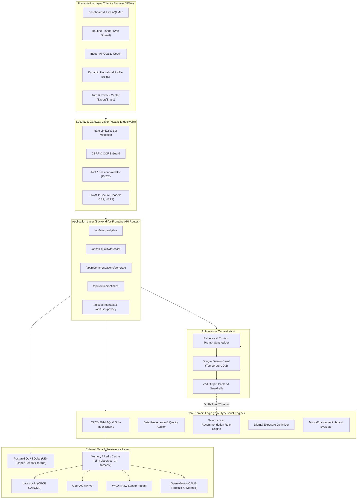
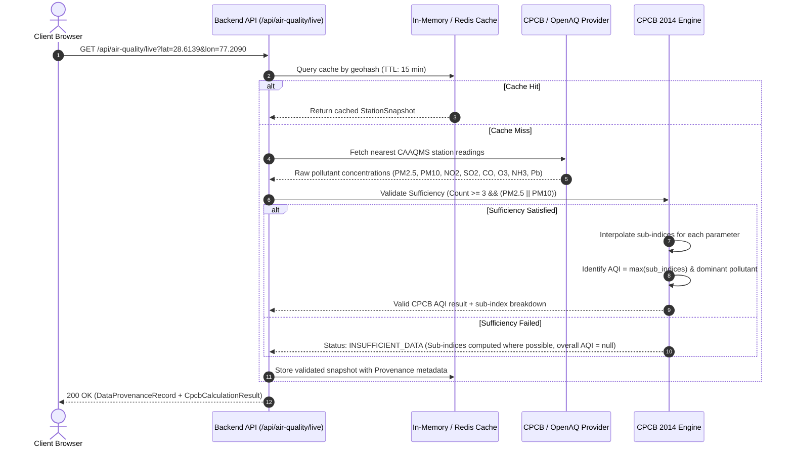
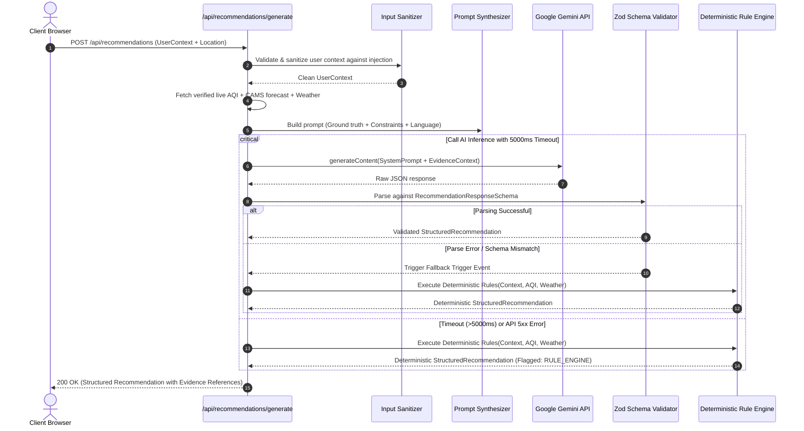

# System Architecture Document

> **Document ID:** HS-ARCH-001  
> **Status:** Draft / Pending Review  
> **Target Platform:** Next.js (App Router) / Node.js TypeScript  
> **Compliance:** OWASP ASVS 5.0.0 Level 2, WCAG 2.1 AA

---

## 1. System Topology & Component Overview

HawaSaathi adopts a modular, clean hexagonal architecture. Domain logic (AQI calculation, routine optimization, hazard evaluation) is strictly decoupled from external I/O (APIs, LLM providers, databases, and UI components).



---

## 2. Multi-Tier Layer Specifications

### 2.1 Presentation Layer (Client)
- **Framework:** Next.js (React 19, TypeScript Strict).
- **Design System:** Responsive Tailwind CSS with accessible Radix UI primitives.
- **State Strategy:** React Context / Zustand for ephemeral client state; React Query (TanStack Query) for network caching with optimistic UI updates.
- **State Handling Contract:** Every view implements the 5 canonical UI states:
  1. `idle`: Initial ready state.
  2. `loading`: Skeleton loaders with `aria-busy="true"` and descriptive accessibility announcements.
  3. `empty`: Meaningful zero-data state with suggested user action.
  4. `error`: Non-technical, actionable error message with a retry mechanism.
  5. `stale / unavailable`: Clear visual badges indicating data latency or offline cache fallback.

### 2.2 Security & Gateway Layer (Edge Middleware)
- **CORS & CSRF:** Strict origin verification; SameSite=Lax/Strict for authentication cookies.
- **Security Headers:** Strict Content Security Policy (CSP), `X-Frame-Options: DENY`, `X-Content-Type-Options: nosniff`, `Referrer-Policy: strict-origin-when-cross-origin`, `Strict-Transport-Security`.
- **Rate Limiting:** In-memory token bucket (100 req/min for general routes, 10 req/min for AI generation).

### 2.3 Backend-for-Frontend (BFF) Application Layer
- **Responsibility:** Validates incoming payloads using Zod, handles authentication token verification, coordinates upstream service calls, enforces server-side caching, and masks upstream credentials.
- **Zero Client Leakage:** API credentials (`DATA_GOV_IN_API_KEY`, `OPENAQ_API_KEY`, `GEMINI_API_KEY`, `DATABASE_URL`) are isolated exclusively to server-side memory.

### 2.4 Core Domain Layer (Pure Business Logic)
- **Decoupled & Testable:** Contains zero network or database dependencies.
- **Key Modules:**
  1. `cpcb-engine`: Implements MoEFCC / CPCB 2014 breakpoint linear interpolation.
  2. `exposure-optimizer`: Calculates diurnal exposure curves and evaluates schedule shifts.
  3. `indoor-evaluator`: Calculates air changes per hour (ACH), CADR requirements, and cooking ventilation risk scores.
  4. `deterministic-recommender`: Expert rule system operating on ground measurements and user constraints without AI dependency.

### 2.5 AI Orchestration Layer
- **Model:** Google Gemini API (structured JSON output mode).
- **Prompt Structure:** Strict system directives preventing AQI hallucination; dynamically injects validated ground truth evidence and user micro-environment context.
- **Fail-Safe Mechanism:** Hard circuit breaker (5000ms timeout). If Gemini fails or outputs invalid JSON, `DeterministicRecommender` executes automatically.

---

## 3. Data Flow & Interaction Sequence Diagrams

### 3.1 Live Air Quality Ingestion & CPCB Calculation Flow



### 3.2 AI Decision & Deterministic Fallback Sequence



---

## 4. Architectural Decision Records (ADRs)

### ADR-01: Framework Selection — Next.js (App Router) with Node.js Runtime
- **Context:** Need unified development, server-side credential isolation, API route handlers, and static export options within a $<10\text{ MB}$ repository limit.
- **Decision:** Use Next.js 15+ App Router with strict Node.js runtime for backend routes.
- **Justification:**
  - Zero server secrets leaked to the client bundle.
  - Native TypeScript compilation and tree-shaking keeping build sizes minimal.
  - Standard edge middleware for rate-limiting, CORS, and security header injection.
  - Eliminates the overhead of separate frontend and backend repository structures.

### ADR-02: Zero-Hallucination AQI Policy
- **Context:** LLMs frequently hallucinate mathematical interpolations and fabricate air quality readings when asked to assess sensor conditions.
- **Decision:** Strictly forbid the LLM from calculating, estimating, or predicting AQI.
- **Justification:** CPCB AQI is a legally defined regulatory formula. All AQI calculations are handled exclusively by `cpcb-calculator.ts` with strict unit-tested breakpoint tables. The LLM acts strictly as a contextual advisory synthesizer over verified numbers.

### ADR-03: Dual Recommendation Strategy (AI + Deterministic Fallback)
- **Context:** Free-tier Gemini API can encounter rate limits (429), regional downtime (503), or schema compliance variations.
- **Decision:** Build a complete, standalone deterministic rule engine (`DeterministicRecommender`) based on CPCB health advisory matrices and WHO guidelines.
- **Justification:** Guarantees 100% platform availability and instant response times even during upstream LLM outages.

### ADR-04: Dynamic Context Modeling vs Fixed Personas
- **Context:** Urban Indian life is too heterogeneous for fixed enum roles (e.g. `STUDENT`, `OFFICE_WORKER`, `RUNNER`).
- **Decision:** Represent users via arbitrary composition of:
  - Household members (ages, specific optional health indicators).
  - Living environment (floor, ventilation, air purifier CADR, cooking fuels).
  - Daily routine timeline (commute modes, outdoor segments, flexible shifts).
- **Justification:** Enables personalized recommendations (e.g., advising an asthma-prone family member to travel by Metro 45 minutes later during inversion lifting).

### ADR-05: Strict Separation of Observed Sensors vs Modelled Forecasts
- **Context:** Atmospheric dispersion models (CAMS Global) cover vast grid cells (~45 km) and represent theoretical estimates, whereas CAAQMS represents physical point-source reality.
- **Decision:** Maintain separate data pipelines and distinct UI treatments.
- **Justification:** Ensures scientific validity. Users are never misled into believing a regional satellite dispersion forecast is an active ground sensor.

---

## 5. Proposed Project Folder Structure

```text
/
├── .github/
│   └── workflows/
│       ├── ci.yml                 # Lint, Typecheck, Unit/Integration tests
│       └── repo-safeguards.yml    # Branch check (main only) & size check (<10MB)
├── docs/                          # Architectural & specification documents
│   ├── requirements-matrix.md
│   ├── architecture.md
│   ├── data-source-verification.md
│   ├── user-context-model.md
│   ├── threat-model.md
│   ├── testing-strategy.md
│   └── privacy-and-authentication.md
├── scripts/
│   ├── check-repo-size.sh         # Ensures repo size < 10 MB
│   └── verify-single-branch.sh    # Ensures current branch is 'main'
├── src/
│   ├── app/                       # Next.js App Router (Pages & API routes)
│   │   ├── api/
│   │   │   ├── air-quality/
│   │   │   │   ├── live/route.ts
│   │   │   │   └── forecast/route.ts
│   │   │   ├── recommendations/
│   │   │   │   └── generate/route.ts
│   │   │   ├── routine/
│   │   │   │   └── optimize/route.ts
│   │   │   └── user/
│   │   │       ├── context/route.ts
│   │   │       └── privacy/route.ts
│   │   ├── layout.tsx
│   │   ├── page.tsx               # Live AQI Dashboard & Search
│   │   ├── routine/page.tsx       # Daily Routine Planner
│   │   ├── indoor/page.tsx        # Indoor Air Quality Coach
│   │   └── settings/page.tsx      # Household & Privacy Management
│   ├── components/                # Modular React UI components
│   │   ├── aqi/                   # StationBadge, PollutantCard, CpcbGauge
│   │   ├── indoor/                # VentilationGuide, FiltrationCalculator
│   │   ├── routine/               # TimelineView, CommuteSelector
│   │   └── shared/                # Navbar, Footer, LanguageSwitcher, Alert
│   ├── config/                    # Static configuration & environment schemas
│   │   ├── env.ts                 # Validated environment variables (Zod)
│   │   └── rate-limits.ts         # Rate limit thresholds
│   ├── domain/                    # Pure business logic (Zero I/O dependencies)
│   │   ├── cpcb/                  # Breakpoint interpolator & sufficiency checker
│   │   ├── indoor/                # Ventilation & hazard evaluation rules
│   │   ├── routine/               # Exposure curves & schedule shifting
│   │   └── user-context/          # Context aggregators & risk scorers
│   ├── i18n/                      # Localization (English, Bengali, Hindi)
│   │   ├── dictionaries/
│   │   │   ├── en.json
│   │   │   ├── bn.json
│   │   │   └── hi.json
│   │   └── index.ts
│   ├── schemas/                   # Zod boundary validation contracts
│   │   ├── air-quality.schema.ts
│   │   ├── provenance.schema.ts
│   │   ├── recommendation.schema.ts
│   │   ├── routine.schema.ts
│   │   └── user-context.schema.ts
│   ├── server/                    # Server-side I/O services & infrastructure
│   │   ├── ai/                    # Gemini client, prompt synthesizer, fallback engine
│   │   ├── air-quality/           # CPCB, OpenAQ, Open-Meteo providers
│   │   ├── auth/                  # Guest sessions, OAuth PKCE, Magic Link
│   │   └── db/                    # Tenant-isolated storage & privacy repository
│   └── types/                     # Shared TypeScript interfaces & declarations
├── tests/                         # Comprehensive testing suite
│   ├── unit/                      # Domain logic unit tests
│   ├── integration/               # API contract & external service mock tests
│   ├── security/                  # 3,000+ Automated ASVS 5.0.0 security tests
│   │   ├── fuzzers/
│   │   ├── injection/
│   │   ├── auth/
│   │   └── idor/
│   ├── a11y/                      # Axe accessibility test suite
│   └── e2e/                       # Playwright browser end-to-end flows
├── AGENTS.md                      # Persistent agent rules & constraints
├── README.md                      # Project overview & documentation index
├── tsconfig.json                  # Strict TypeScript configuration
└── package.json                   # Dependencies & build scripts
```
