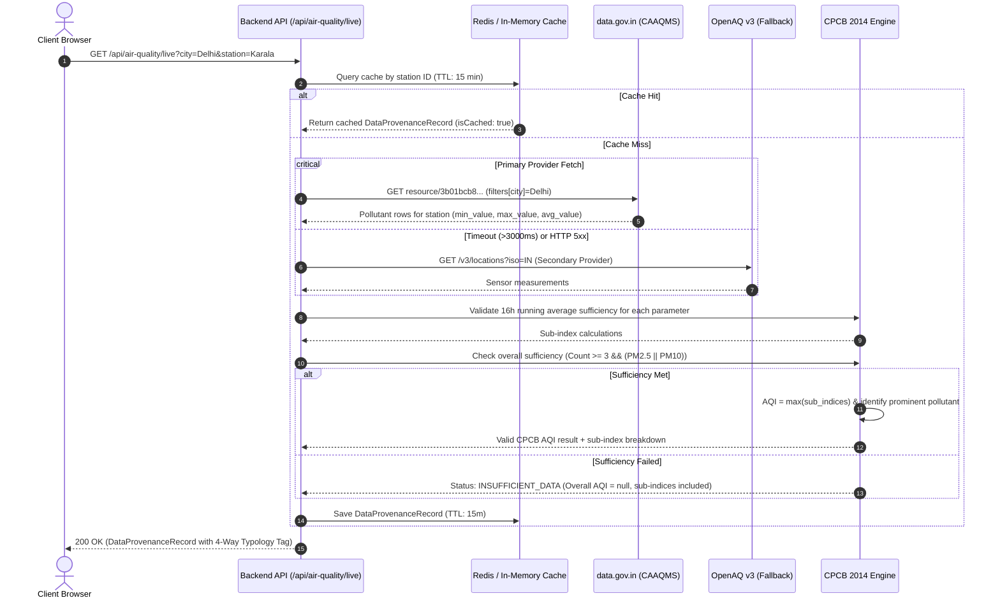

# System Architecture Document

> **Document ID:** HS-ARCH-001  
> **Status:** Revised Baseline (Phase 0 Audit Revisions)  
> **Target Framework:** Next.js 16.x (App Router) / Node.js TypeScript ($\ge 20.x$)  
> **Compliance:** OWASP ASVS 5.0.0 Level 2, MoEFCC CPCB NAQI (2014), WCAG 2.1 AA

---

## 1. System Topology & Hexagonal Architecture

HawaSaathi adopts a modular hexagonal architecture. All external interactions (data providers, generative AI inference, authentication, and persistence) are strictly isolated through ports and adapters, keeping pure domain logic independent of runtime environments.

```mermaid
flowchart TD
    subgraph Client["Presentation Layer (Client Browser / PWA)"]
        UI_Home["Live AQI & Map Dashboard"]
        UI_Routine["24h Diurnal Routine Planner"]
        UI_Indoor["Indoor Air Quality Coach"]
        UI_Context["Dynamic Household Profile Builder"]
        UI_Auth["Auth Center (Google / Magic Link / Guest)"]
        FB_ClientAuth["Firebase Client SDK (Auth Only)"]
        Storage_Local["Browser sessionStorage (Guest Mode Only)"]
    end

    subgraph Edge["Security & Gateway Layer (Next.js Middleware)"]
        MW_Rate["Shared Upstash Redis Rate Limiter"]
        MW_Headers["OWASP Secure Headers (CSP, HSTS)"]
        MW_CSRF["CSRF & Origin Verification"]
    end

    subgraph BFF["Application Layer (Backend-for-Frontend API Routes)"]
        API_AQI["/api/air-quality/live"]
        API_Forecast["/api/air-quality/forecast"]
        API_Recommend["/api/recommendations/generate"]
        API_Routine["/api/routine/optimize"]
        API_User["/api/user/profile & /api/user/privacy"]
        SRV_AuthGuard["Token Verifier (Firebase Admin SDK)"]
    end

    subgraph Domain["Core Domain Logic (Pure TypeScript Engine)"]
        ENG_CPCB["CPCB 2014 NAQI & 16h Sufficiency Engine"]
        ENG_Prov["Provenance & Quality Auditor"]
        ENG_Rules["Deterministic Recommendation Engine"]
        ENG_Routine["Diurnal Exposure Optimizer"]
        ENG_Indoor["Micro-Environment Hazard Evaluator"]
    end

    subgraph AI["AI Inference Orchestration (Server Runtime Only)"]
        AI_Prompt["Evidence & Context Prompt Synthesizer"]
        AI_Gemini["Google Gemini Client (Temperature 0.2)"]
        AI_Zod["Zod Output Parser & Citation Verifier"]
    end

    subgraph Data["External Data & Persistence Infrastructure"]
        EXT_CPCB["CPCB CAAQMS (data.gov.in)"]
        EXT_OpenAQ["OpenAQ API v3 (iso=IN)"]
        EXT_CAMS["Open-Meteo CAMS Global Forecast"]
        EXT_Weather["Open-Meteo Weather (Dispersion)"]
        EXT_OSM["OpenStreetMap Carto / Stadia / PMTiles"]
        DB_Firestore["Cloud Firestore (Server Admin SDK Access Only)"]
        CACHE_Redis["Upstash Redis / In-Memory KV Cache"]
    end

    Client --> Edge
    Edge --> BFF
    Client -->|Obtain ID Token| FB_ClientAuth
    Client -.->|Guest data strictly local| Storage_Local
    BFF --> SRV_AuthGuard
    BFF --> Domain
    BFF --> AI
    Domain --> CACHE_Redis
    CACHE_Redis --> EXT_CPCB
    CACHE_Redis --> EXT_OpenAQ
    CACHE_Redis --> EXT_CAMS
    CACHE_Redis --> EXT_Weather
    Client -->|Map Tile Display| EXT_OSM
    AI --> AI_Prompt --> AI_Gemini --> AI_Zod
    AI_Zod -.->|On Timeout (>5s) or Schema Error| ENG_Rules
    BFF -->|UID-Scoped Server Operations| DB_Firestore
```

---

## 2. Multi-Tier Layer Specifications

### 2.1 Presentation Layer (Client)
- **Framework:** Next.js 16.x (React 19, Strict TypeScript, ES2022).
- **Styling & Components:** Responsive Tailwind CSS with unstyled, accessible Radix UI primitives.
- **Client Authentication:** Firebase Client SDK used strictly for identity acquisition (Google Sign-In or Passwordless Email Link) to obtain a short-lived Firebase ID token.
- **Guest Experience:** Unauthenticated visitors operate 100% locally. Household configurations and daily routines are held in browser `sessionStorage` with zero server-side database footprint.
- **State Handling Contract:** Every async view handles the 5 standard states:
  1. `idle`: Ready for user input.
  2. `loading`: Accessible skeleton loaders with `aria-live="polite"` and `aria-busy="true"`.
  3. `empty`: Meaningful zero-data state with suggested actions.
  4. `error`: Non-technical, actionable error message with a retry trigger.
  5. `unavailable / stale`: Clear visual warning badge displaying the exact observation timestamp and cache age.

### 2.2 Security & Gateway Layer (Next.js Edge Middleware)
- **Shared Rate Limiting:** Enforces sliding-window rate limits backed by Upstash Redis (100 req/min for general queries, 10 req/min for AI recommendation synthesis) ensuring consistent limits across serverless instances.
- **Security Headers:** Strict Content Security Policy (CSP), `X-Frame-Options: DENY`, `X-Content-Type-Options: nosniff`, `Referrer-Policy: strict-origin-when-cross-origin`, `Strict-Transport-Security`.
- **CORS & CSRF:** Strict origin matching on all mutating API routes.

### 2.3 Backend-for-Frontend (BFF) Application Layer
- **Role:** Authoritative server boundary. Exposes REST endpoints, validates incoming payloads using Zod, handles identity verification via Firebase Admin SDK, orchestrates data aggregation, and caches external API responses.
- **Authoritative Database Pattern:** Next.js BFF server routes interact with Cloud Firestore using the Firebase Admin SDK. Direct client SDK reads and writes to Firestore are disabled (`allow read, write: if false;` in `firestore.rules`).
- **UID Derivation:** The backend derives the user's `uid` directly from the cryptographically verified ID token (`decodedToken.uid`). All Firestore queries are enforced at the repository level:
  ```typescript
  // Canonical Server Repository Pattern: src/server/db/user-repository.ts
  export async function getHouseholdProfile(adminDb: FirebaseFirestore.Firestore, verifiedUid: string, householdId: string) {
    const doc = await adminDb
      .collection("users")
      .doc(verifiedUid) // Enforces UID tenant boundary
      .collection("households")
      .doc(householdId)
      .get();
    return doc.exists ? doc.data() : null;
  }
  ```

### 2.4 Core Domain Layer (Pure TypeScript Business Logic)
- **Decoupled & Deterministic:** Zero network or database dependencies. Can be tested 100% in isolation with Vitest.
- **Key Modules:**
  1. `cpcb-calculator`: Implements MoEFCC 2014 breakpoint linear interpolation, 16-hour running-average sufficiency rules, and dominant pollutant selection.
  2. `exposure-optimizer`: Calculates diurnal exposure curves and evaluates schedule shifts against diurnal pollution peaks.
  3. `indoor-advisor`: Evaluates ventilation windows based on outdoor/indoor particulate gradients and computes CADR requirements.
  4. `deterministic-recommender`: Local rule-based recommendation engine operating strictly on verified CPCB data and user constraints. Does **never invent measurements**.

### 2.5 AI Inference Orchestration Layer
- **Provider & SDK:** Google Gemini API via official `@google/genai` SDK on the server runtime.
- **Configuration:** `temperature: 0.2`, structured JSON output mode with JSON schema matching `RecommendationResponseSchema`.
- **Defensible Factuality Pipeline:**
  - Pre-calculated, deterministic CPCB metrics and meteorological parameters are injected as immutable facts into the system prompt.
  - The model is explicitly forbidden from calculating or altering AQI.
  - Server-side output validation parses all model outputs through Zod.
  - All factual claims must reference verified evidence IDs supplied in the prompt; invalid citations fail validation.
- **Availability Objective:** 99.9% uptime is an **architectural engineering design objective**, not an achieved contractual SLA.
- **Circuit Breaker:** 5,000 ms timeout. Automatic switchover to `DeterministicRecommender` on timeout, HTTP 429/5xx, or schema mismatch.

---

## 3. Data Flow & Interaction Sequence Diagrams

### 3.1 Live Air Quality Ingestion & CPCB Calculation Flow



---

## 4. Map Integration & Tile Provider Specification

- **Baseline Tile Provider:** OpenStreetMap Standard Tile Layer rendered with OSM Carto style (`https://tile.openstreetmap.org/{z}/{x}/{y}.png`).
- **Licensing & Attribution:**
  - Geodata is licensed under the Open Data Commons Open Database License (ODbL) 1.0.
  - Cartography / tile images from OSMF tile servers are published as a Produced Work under ODbL 1.0 (effective July 1, 2020; the previous CC BY-SA 2.0 license no longer applies).
  - Mandatory Attribution: `© OpenStreetMap contributors` rendered on all map views and linked to `https://www.openstreetmap.org/copyright`.
- **OSMF Tile Policy Compliance:**
  - Standard browser-initiated requests carry standard browser headers (custom User-Agent is not required or feasible on browser `` requests).
  - Client-side HTTP caching is strictly respected (Leaflet leverages browser cache honoring OSMF `Cache-Control` headers).
  - Bulk pre-downloading or automated tile scraping is prohibited.
- **Production Alternatives:** If application traffic grows beyond OSMF acceptable usage, the platform supports:
  1. **Stadia Maps (Alidade Smooth):** Cloud-hosted tiles with 200k free monthly requests and commercial SLA.
  2. **CARTO Basemaps:** Positron / Dark Matter basemaps with explicit commercial terms.
  3. **Self-Hosted Vector Tiles (Protomaps / PMTiles):** Static vector PMTiles served from Cloudflare R2 / AWS S3 using MapLibre GL. Zero server compute, infinite scalability, and total operational autonomy.
