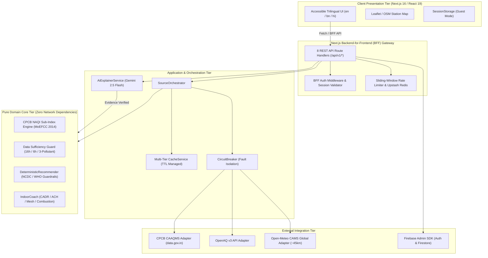

<!-- SPDX-License-Identifier: Apache-2.0 -->
# HawaSaathi Phase 2 Architecture Specification

> **Document ID:** HS-ARCH-P2-001  
> **Status:** Phase 2 Complete  
> **Framework:** Next.js 16.x App Router, React 19, TypeScript Strict Mode  
> **Security Baseline:** OWASP ASVS 5.0.0 Level 2  
> **Regulatory Standard:** MoEFCC CPCB NAQI (2014), DPDP Act 2023  

---

## 1. System Overview & Clean Architecture

HawaSaathi (हवासाथੀ / হাওয়াসাথী) is architected using strict separation of concerns, decoupling domain business logic, external environmental provider adapters, application orchestration, security gateways, and client visual presentation.

---

## 2. Core Architectural Pillars

### 2.1 The Four-Way Data Typology Invariant
Every air quality data point flowing through HawaSaathi carries an immutable `DataTypology` tag:
- **Type A (`TYPE_A_OFFICIAL_CPCB_AQI`):** Direct bulletin AQI published officially by CPCB CAAQMS.
- **Type B (`TYPE_B_CALCULATED_CPCB_AQI`):** Independently computed by HawaSaathi's deterministic engine from validated raw ground observations using official MoEFCC NAQI (2014) piecewise linear interpolation.
- **Type C (`TYPE_C_RAW_MEASUREMENT`):** Physical ground sensor readings ($\mu\text{g/m}^3$ or $\text{mg/m}^3$) with timestamp, averaging window, and provenance metadata.
- **Type D (`TYPE_D_MODEL_FORECAST`):** Atmospheric simulation forecast from Open-Meteo CAMS Global (~45 km spatial resolution).

**Architectural Invariant:** Type D atmospheric model forecasts are strictly supplementary. They are **NEVER substituted into ground station calculations** and never used to calculate CPCB AQI.

### 2.2 Dynamic Household Context (Anti-Enum Architecture)
HawaSaathi explicitly rejects static enum personas (`type Persona = 'athlete' | 'cop' | 'elderly'`). Real urban households feature multi-generational residents with varying physiological sensitivities, diverse commute patterns, and distinct housing micro-environments. Context is modeled dynamically through composable sensitivity flags, transit mode profiles, and dwelling characteristics.

### 2.3 Guest Mode & Privacy Preservation
- **Guest-First:** Users can fully monitor real-time air quality, view station maps, explore CAMS forecasts, plan routines, and use the indoor coach without creating an account.
- **Client-Side Isolation:** Guest user context is stored exclusively in client-side `sessionStorage`. Zero guest data is persisted to cloud databases.
- **DPDP Act 2023 Compliance:** Authenticated users enjoy 1-click machine-readable JSON export and 1-click cascading hard delete across all Firestore profile data.

---

## 3. Technology Matrix

- **Runtime & Framework:** Node.js $\ge 20.x$, Next.js 16.4.6 (App Router with Turbopack), React 19.
- **Language:** TypeScript 5.9 with Strict Mode (`strict: true`, `noImplicitAny: true`, `noUncheckedIndexedAccess: true`).
- **Validation:** Zod schemas across all external boundaries (ingress, egress, and configuration).
- **Styling:** Tailwind CSS with responsive, accessible semantic components.
- **Mapping:** OpenStreetMap Carto tiles with Leaflet, complying with OSM Foundation tile usage policies.
- **Testing:** Vitest v5.1.1 with 647 automated test cases (147 Phase 1 + 500 Phase 2).
