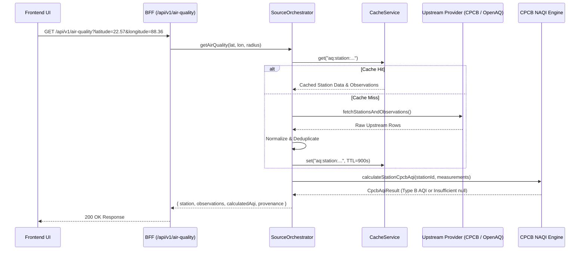

<!-- SPDX-License-Identifier: Apache-2.0 -->
# HawaSaathi Phase 2 Environmental Provider Integration Guide

> **Document ID:** HS-INT-P2-001  
> **Status:** Phase 2 Complete  
> **Target Providers:** CPCB CAAQMS (`data.gov.in`), OpenAQ v3 API, Open-Meteo CAMS Global  

---

## 1. Provider Landscape & Orchestration Hierarchy

HawaSaathi orchestrates environmental data across three primary upstream feeds:

```
[User Request] 
      │
      ▼
[SourceOrchestrator]
      │
      ├─► 1. CPCB CAAQMS (Primary Ground Authority)
      │      └─ Fetch Real-Time Sensor Concentration Rows (data.gov.in)
      │
      ├─► 2. OpenAQ v3 (Secondary Ground Verification & Fallback)
      │      └─ Fetch Geo-located Station Observations (/v3/locations)
      │
      └─► 3. Open-Meteo CAMS Global (Supplementary Atmospheric Forecast)
             └─ Fetch 24h Hourly Spatial Forecast (~45 km grid)
```

---

## 2. Upstream Provider Details

### 2.1 CPCB CAAQMS (Central Pollution Control Board via data.gov.in)
- **API Endpoint:** `https://api.data.gov.in/resource/3b01bcb8-0b14-4abf-b6f2-c1bfd384ba69`
- **Data Contract Semantics:**
  - In the CPCB dataset, each returned record represents an **individual pollutant measurement row**, NOT a unique monitoring station.
  - A physical station typically produces 4 to 8 rows per hourly bulletin.
  - HawaSaathi groups records by `(state, city, station)` to establish physical station identities.
- **Pollutants Monitored:**
  - $PM_{10}, PM_{2.5}, NO_2, SO_2, NH_3, Pb$ (measured in $\mu\text{g/m}^3$).
  - $CO$ (measured in $\text{mg/m}^3$).
  - $O_3$ (measured in $\mu\text{g/m}^3$).
- **Averaging Window Standard:**
  - Particulates & Gases ($PM_{10}, PM_{2.5}, NO_2, SO_2, NH_3, Pb$): 24-hour statutory averaging window (requires $\ge 16$ hours of valid readings).
  - Fast-reacting gases ($CO, O_3$): 8-hour statutory averaging window (requires $\ge 6$ hours of valid readings).
- **Licensing & Attribution:**
  - License: Government Open Data License - India (GODL-India).
  - Mandatory Attribution: `Data Source: Central Pollution Control Board (CPCB), Ministry of Environment, Forest and Climate Change via data.gov.in`.

### 2.2 OpenAQ v3 API
- **API Endpoint:** `https://api.openaq.org/v3/locations`
- **Authentication:** `X-API-Key: <OPENAQ_API_KEY>` (injected strictly server-side).
- **Capabilities:**
  - Proximity search by coordinates (`coordinates=lat,lon&radius=25000`).
  - Country-level filtering (`iso=IN`).
  - Sensor metadata including physical measurement units and provider attribution.
- **Licensing:**
  - Multi-license attribution model: OpenAQ platform terms + individual provider licenses (CC BY 4.0, ODbL 1.0, or Agency Specific).

### 2.3 Open-Meteo CAMS Global Forecast
- **API Endpoint:** `https://air-quality-api.open-meteo.com/v1/air-quality`
- **Parameters:**
  - Coordinates: `latitude`, `longitude`.
  - Hourly variables: `pm2_5`, `pm10`, `nitrogen_dioxide`, `sulphur_dioxide`, `ozone`, `carbon_monoxide`.
  - Domain: `cams_global` (Copernicus Atmosphere Monitoring Service European Centre for Medium-Range Weather Forecasts - ECMWF).
  - Spatial resolution: ~45 km global atmospheric grid.
- **Licensing:**
  - Creative Commons Attribution 4.0 International (`CC BY 4.0`) / Copernicus CAMS.
  - Open-Meteo non-commercial terms (commercial licenses supported via API key configuration).

---

## 3. Data Ingestion & Transformation Lifecycle



---

## 4. Error Handling & Fault Isolation

Every external network request is guarded by:
1. **Request Timeout:** 8000ms hard ceiling with `AbortController`.
2. **Circuit Breaker:** Opens after 5 consecutive upstream failures; enters `HALF_OPEN` probe state after 30-second cooldown.
3. **Structured Domain Exceptions:**
   - `DataSourceUnavailableError`: Upstream returns 5xx or network drops.
   - `DataStaleError`: Upstream data timestamp is older than 24 hours.
   - `InsufficientDataError`: Fewer than 3 valid pollutants monitored or missing particulate parameters.
