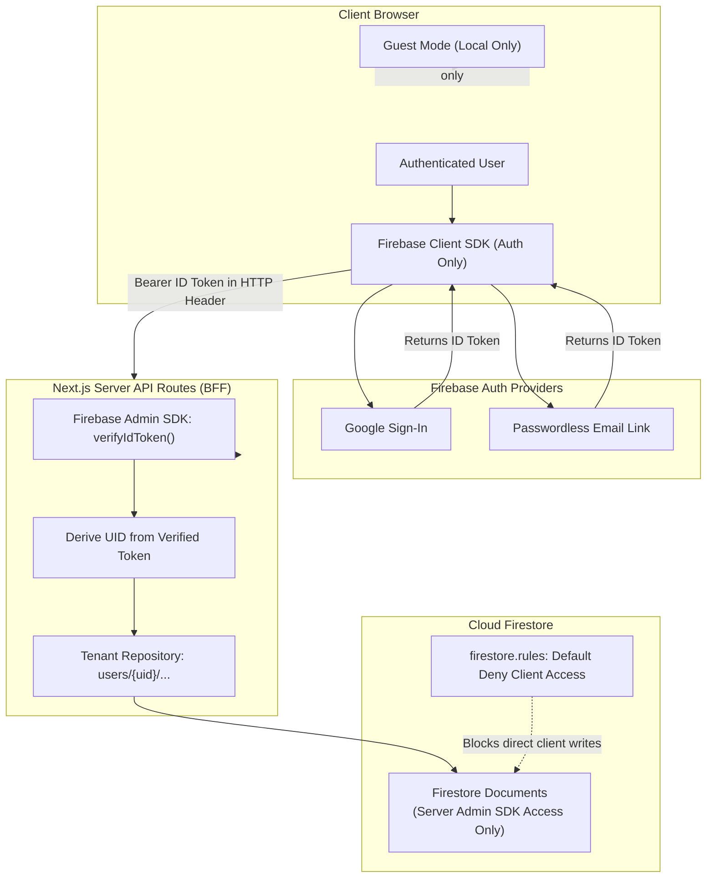

# Privacy Architecture, Authentication & Data Rights

> **Document ID:** HS-PRIV-001  
> **Status:** Revised Baseline (Post-Audit)  
> **Regulatory Alignment:** Digital Personal Data Protection (DPDP) Act 2023 (India), GDPR, OWASP ASVS 5.0.0 Level 2

---

## 1. Privacy Principles & Architectural Tenets

HawaSaathi processes location context, daily commute schedules, and optional user-disclosed respiratory sensitivities.

To ensure strict statutory compliance and user privacy:
1. **Local-Only Guest Tier (Zero Server Persistence):** Core air quality intelligence, routine planning, and indoor guidance do NOT require user account creation. Guest sessions keep state purely in browser memory (`sessionStorage`) with zero database persistence. No unauthenticated user records or anonymous sessions are created in Cloud Firestore.
2. **Data Minimization:** Health information is strictly minimised to optional, non-diagnostic sensitivity checkboxes (e.g. self-reported respiratory sensitivity). The system provides environmental exposure mitigation guidance and **NEVER** diagnoses users.
3. **Purpose Limitation:** User context is consumed strictly for real-time recommendation synthesis and schedule optimization. It is never sold, analyzed for advertising, or shared with third parties.
4. **Ephemeral AI Processing:** User context passed to the Gemini API is processed strictly in-flight. HawaSaathi opts out of third-party model training on user payloads.
5. **Server-Side UID Tenant Isolation:** In our authoritative Next.js Backend-for-Frontend (BFF) architecture, all user mutations flow through server API routes where the Firebase Admin SDK derives the `uid` from the verified token and enforces strict tenant ownership on every repository operation.

---

## 2. Authentication Architecture



### 2.1 Supported User Access Flows

#### Flow A: Guest Access (100% Local-Only)
- The user accesses all core views without an account.
- Household composition and routine schedules are stored purely within browser `sessionStorage`.
- Outgoing API requests for AQI and recommendations pass ephemeral parameters in the request body.
- When the browser tab closes, the data is destroyed. No user record exists on the backend.

#### Flow B: Google Sign-In (Firebase Auth)
- User signs in using Firebase Client SDK (`GoogleAuthProvider` via popup or redirect).
- Client acquires a short-lived, cryptographically signed Firebase ID token.
- Client passes the ID token in the `Authorization: Bearer <token>` header to Next.js BFF routes (`/api/user/...`).
- Zero custom OAuth client secrets are exposed to the client.

#### Flow C: Passwordless Email Link (Firebase Auth)
- User enters their email $\to$ Firebase client calls `sendSignInLinkToEmail(auth, email, actionCodeSettings)`.
- Firebase Authentication delivers a secure sign-in link to the user's inbox.
- User clicks the link $\to$ client completes authentication via `signInWithEmailLink(auth, email, window.location.href)`.
- Expiry and single-use link consumption are enforced directly by the Firebase Authentication platform.
- Eliminates password compromise risks (credential stuffing, dictionary attacks).

---

## 3. Authoritative Firestore Access & Tenant Isolation Model

### 3.1 Architecture Decision: Backend-for-Frontend (BFF) with Admin SDK
HawaSaathi establishes **Next.js BFF Server Routes with Firebase Admin SDK** as the authoritative persistence architecture:
1. **Client Isolation:** The Firebase Client SDK is used exclusively for authentication. Direct client reads and writes to Cloud Firestore are prohibited.
2. **Defense-in-Depth Security Rules:** `firestore.rules` enforces default deny for all client SDK operations:
   ```javascript
   rules_version = '2';
   service cloud.firestore {
     match /databases/{database}/documents {
       match /{document=**} {
         allow read, write: if false; // All mutations must flow through Next.js BFF
       }
     }
   }
   ```
3. **Server-Side Token Verification & UID Derivation:**
   - Every protected API route validates the incoming token:
     ```typescript
     // src/server/auth/token-guard.ts
     import { adminAuth } from "@/server/config/firebase-admin";

     export async function authenticateRequest(req: Request): Promise<string> {
       const authHeader = req.headers.get("Authorization");
       if (!authHeader || !authHeader.startsWith("Bearer ")) {
         throw new UnauthorizedError("Missing or malformed Authorization header");
       }
       const token = authHeader.split("Bearer ")[1];
       const decodedToken = await adminAuth.verifyIdToken(token);
       return decodedToken.uid; // Cryptographically verified UID
     }
     ```
4. **UID Ownership Enforcement in Repository:**
   - The Firebase Admin SDK bypasses client security rules; therefore, the server-side repository strictly scopes all paths using the verified UID:
     ```typescript
     // src/server/db/user-repository.ts
     export async function saveHousehold(adminDb: FirebaseFirestore.Firestore, uid: string, data: HouseholdContext) {
       return adminDb
         .collection("users")
         .doc(uid) // Enforces tenant isolation
         .collection("households")
         .doc(data.householdId)
         .set({ ...data, updatedAt: new Date().toISOString() });
     }
     ```

---

## 4. User Rights: Data Export & Account Deletion (DPDP Act & GDPR)

### 4.1 Right to Data Portability (1-Click Machine-Readable Export)
- **Endpoint:** `GET /api/user/privacy/export`
- **Output:** Machine-readable JSON package conforming to `UserDataExportSchema`:
  - Account metadata (creation date, verified email, UID).
  - Saved household profiles and dwelling characteristics.
  - Saved daily routine activities and schedule preferences.
  - Audit trail of previous recommendation sessions (with anonymized coordinates).
- **Verification:** Request must include a valid Firebase ID token verified by the backend.

### 4.2 Right to Erasure / "To Be Forgotten" (1-Click Account Deletion)
- **Endpoint:** `DELETE /api/user/privacy/account`
- **Action:** Cascading, permanent hard delete executed by Firebase Admin SDK:
  1. Hard delete all subcollections (`households`, `routines`, `consents`) under `users/{uid}`.
  2. Hard delete the parent document `users/{uid}`.
  3. Delete the user identity from Firebase Authentication (`adminAuth.deleteUser(uid)`).
  4. Revoke active refresh tokens.
- **Audit Requirement:** Minimal pseudonymous audit log (hashed record ID + timestamp) retained for regulatory compliance, containing zero PII.

---

## 5. Zero Secret Leakage Policy

1. **Server-Only Credentials:**
   - `GEMINI_API_KEY`, `DATA_GOV_IN_API_KEY`, `OPENAQ_API_KEY`, `UPSTASH_REDIS_REST_TOKEN`, and Firebase Admin service account keys reside exclusively in server-side environment variables.
2. **Client-Safe Configuration:**
   - Only non-sensitive public identifiers prefixed with `NEXT_PUBLIC_` (`NEXT_PUBLIC_FIREBASE_API_KEY`, `NEXT_PUBLIC_FIREBASE_PROJECT_ID`, `NEXT_PUBLIC_APP_URL`) are allowed in client bundles.
   - Even if client Firebase keys are inspected, direct database manipulation is blocked by the default deny rule in `firestore.rules`.
