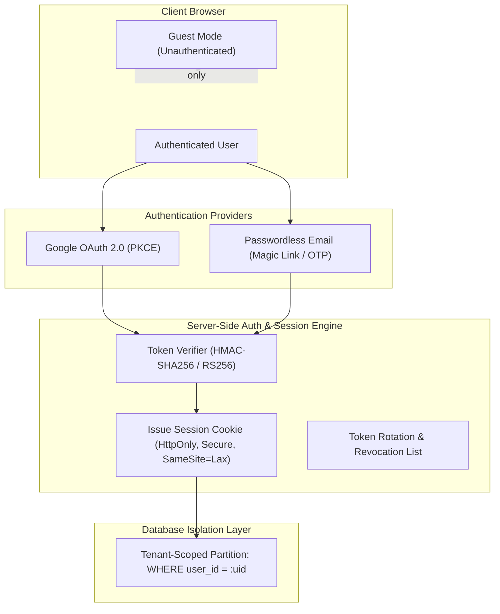

# Privacy Architecture, Authentication & Tenant Isolation

> **Document ID:** HS-PRIV-001  
> **Status:** Approved Baseline  
> **Regulatory Alignment:** Digital Personal Data Protection (DPDP) Act 2023 (India), GDPR, OWASP ASVS 5.0.0 (V2, V3, V4, V8)

---

## 1. Privacy Principles & Architectural Tenets

HawaSaathi deals with potentially sensitive personal information: user geolocation, daily commute schedules, household age distribution, and optional respiratory or cardiovascular health disclosures.

To ensure uncompromising privacy:
1. **Default Guest Tier (Zero Persistence):** Core air quality intelligence, routine planning, and indoor guidance do NOT require user account creation. Guest sessions keep state purely in browser memory (`sessionStorage`) with zero database persistence.
2. **Data Minimization:** Health vulnerabilities are strictly optional. Users can benefit fully from routine optimizations without disclosing medical history.
3. **Purpose Limitation:** User context is consumed strictly for real-time recommendation synthesis and schedule optimization. It is never sold, analyzed for advertising, or shared with third parties.
4. **Ephemeral AI Processing:** Prompts sent to the Gemini API are processed in-flight. HawaSaathi opts out of third-party model training on user payloads.
5. **Absolute Tenant Partitioning:** Every persisted record is strictly scoped to the authenticated user's unique identifier (`UID`).

---

## 2. Authentication Architecture



### 2.1 Supported Authentication Flows

#### Flow A: Guest Access (Zero Server Footprint / Ephemeral Anonymous UID)
- The user accesses all core views without providing an email or password.
- Implemented via:
  - *Option 1 (Default):* Pure client-side `sessionStorage` with zero Firebase network calls.
  - *Option 2 (Optional Cloud Guest):* Firebase Anonymous Authentication (`signInAnonymously`). Provides an ephemeral UID with temporary Firestore storage.
- When an anonymous user decides to save their household permanently, `linkWithCredential` seamlessly links the anonymous session to a Google account or Email Magic Link without data loss.

#### Flow B: Google OAuth 2.0 with PKCE (Proof Key for Code Exchange)
- Implements RFC 7636 via Firebase `GoogleAuthProvider`.
- Uses SHA-256 code challenge to prevent authorization code interception.
- Zero client-exposed client secrets.
- Issues a secure Firebase ID token with cryptographic validation.

#### Flow C: Passwordless Email Magic Link
- User submits email $\to$ Firebase client calls `sendSignInLinkToEmail`.
- Generates a cryptographically signed magic link with an expiration window of exactly 15 minutes.
- Verified on return via `signInWithEmailLink`.
- Single-use constraint: Link is invalidated immediately upon successful consumption.
- Eliminates password compromise risks (credential stuffing, dictionary attacks).

### 2.2 Cloud Firestore Security Rules Specification
Tenant isolation is enforced natively in the database layer via `firestore.rules`:

```javascript
rules_version = '2';
service cloud.firestore {
  match /databases/{database}/documents {
    // Default: Deny all operations
    match /{document=**} {
      allow read, write: if false;
    }

    // Public Station Read-Only Cache (Populated exclusively by Server)
    match /public_stations/{stationId} {
      allow read: if true;
      allow write: if false;
    }

    // Tenant Isolation Boundary: Scoped to User's UID
    match /users/{userId} {
      // User Document
      allow read, write: if request.auth != null && request.auth.uid == userId;

      // Subcollection: Saved Household Profiles
      match /households/{householdId} {
        allow read, write: if request.auth != null && request.auth.uid == userId;
      }

      // Subcollection: Saved Daily Routines
      match /routines/{routineId} {
        allow read, write: if request.auth != null && request.auth.uid == userId;
      }

      // Subcollection: Privacy Consents & Audit Trail
      match /consents/{consentId} {
        allow read, write: if request.auth != null && request.auth.uid == userId;
      }
    }
  }
}
```

### 2.2 Session Management & Token Verification Standards
- **Cookie Security Attributes:**
  - `HttpOnly`: Inaccessible to client JavaScript (XSS mitigation).
  - `Secure`: Transmitted strictly over TLS (HTTPS).
  - `SameSite=Lax` (or `Strict` for mutating actions): CSRF protection.
  - `Path=/`: Scoped to application root.
- **Token Expiry & Refresh:** Access tokens expire after 15 minutes; refresh tokens stored securely with server-side revocation capabilities.

---

## 3. UID-Scoped Data Partitioning (Zero IDOR Guarantee)

Insecure Direct Object Reference (IDOR) is completely eliminated at the architectural data access layer:

```typescript
// Architectural Guard Pattern: src/server/db/tenant-guard.ts

export async function findHouseholdByTenant(
  db: DatabaseClient,
  authenticatedUid: string,
  householdId: string
): Promise<HouseholdEntity | null> {
  // CRITICAL: Query ALWAYS filters by both householdId AND authenticatedUid
  return db.household.findFirst({
    where: {
      id: householdId,
      userId: authenticatedUid // Enforces tenant boundary
    }
  });
}
```

No database query for user-owned assets (routines, saved profiles, alerts) is ever executed without an explicit `userId = :authenticatedUid` constraint.

---

## 4. User Rights: Data Export & Account Deletion (DPDP Act & GDPR)

### 4.1 Right to Data Portability (1-Click JSON Export)
- **Endpoint:** `GET /api/user/privacy/export`
- **Output:** Machine-readable JSON package conforming to `UserDataExportSchema`:
  - Account metadata (creation date, login provider).
  - Saved household profiles and dwelling characteristics.
  - Saved daily routine activities.
  - Audit trail of previous recommendation sessions (with anonymized coordinates).
- **Verification:** User must re-authenticate or possess a valid active session.

### 4.2 Right to Erasure / "To Be Forgotten" (1-Click Account Deletion)
- **Endpoint:** `DELETE /api/user/privacy/account`
- **Action:** Cascading, permanent hard delete:
  ```sql
  DELETE FROM users WHERE id = :authenticated_uid;
  -- Cascades automatically to:
  -- households, members, routines, constraints, and sessions.
  ```
- **Session Revocation:** Immediately clears session cookies and blacklists active tokens.
- **Audit Requirement:** Minimal pseudonymous audit log (hashed record ID + timestamp) retained for regulatory compliance, containing zero PII.

---

## 5. Zero Secret Leakage Architecture

To ensure strict zero secret leakage:
1. **Configuration Hygiene:**
   - Server-only secrets (`GEMINI_API_KEY`, `DATA_GOV_IN_API_KEY`, `OPENAQ_API_KEY`, `AUTH_SECRET`, `DATABASE_URL`) are loaded exclusively in server runtimes.
   - Any client-exposed variable MUST be explicitly prefixed with `NEXT_PUBLIC_` and restricted to public metadata (e.g. `NEXT_PUBLIC_APP_URL`, `NEXT_PUBLIC_APP_VERSION`).
2. **Automated Static Bundle Inspection:**
   - Build-time CI check scans compiled client chunks (`.next/static/**`) for regex signatures of private keys, API secrets, and internal endpoints.
   - Any match fails the build instantly.
