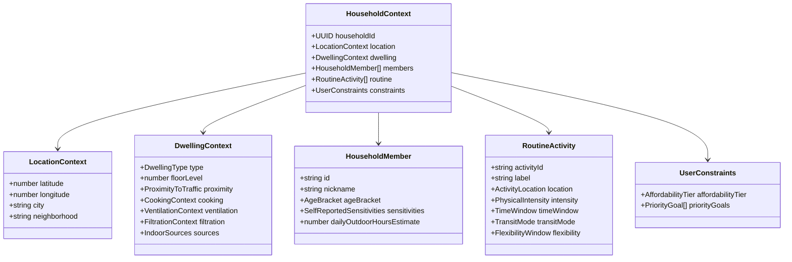

# Dynamic User Context Data Model

> **Document ID:** HS-CTX-001  
> **Status:** Revised Baseline (Post-Audit)  
> **Key Architectural Mandates:** Zero Static Persona Enums. Data Minimization. Non-Diagnostic Health Disclosures.

---

## 1. Context Modeling Philosophy & Non-Clinical Scope

Traditional platforms reduce people to static labels (e.g. `"Athlete"`, `"Elderly"`, `"Patient"`). In reality, real households in Indian cities feature:
- Multi-generational composition (infants, adults, seniors sharing a home).
- Varied housing micro-environments (high-rise vs ground floor, LPG vs induction vs biomass cooking, exhaust ventilation, presence and CADR of air purifiers).
- Multi-modal daily commutes (walking, e-rickshaws, metro trains, two-wheelers, non-AC buses).
- Variable daily schedules with shiftable windows ($\pm 30$ to $120$ minutes).

### Non-Diagnostic Boundary Directive
HawaSaathi is strictly an environmental exposure mitigation and activity-planning platform. **It does NOT provide medical diagnosis or clinical treatment.** Health-related disclosures are strictly optional, minimised to non-diagnostic sensitivity checkboxes (e.g. self-reported respiratory or cardiovascular sensitivity), and consumed solely to calibrate public health advisory thresholds.



---

## 2. Canonical Zod Schema Specification

```typescript
import { z } from "zod";

// ==========================================
// 1. DWELLING & INDOOR MICRO-ENVIRONMENT
// ==========================================

export const CookingFuelSchema = z.enum([
  "LPG",
  "INDUCTION_ELECTRIC",
  "PIPED_NATURAL_GAS",
  "BIOMASS_KEROSENE",
  "MIXED"
]);

export const DwellingContextSchema = z.object({
  dwellingType: z.enum([
    "STANDALONE_HOUSE",
    "APARTMENT_LOW_RISE",   // Floors 0-3
    "APARTMENT_HIGH_RISE",  // Floor 4+
    "INFORMAL_SETTLEMENT"
  ]),
  floorLevel: z.number().int().min(0).max(100),
  proximityToMajorRoadMeters: z.number().int().nonnegative(),
  cooking: z.object({
    primaryFuel: CookingFuelSchema,
    kitchenVentilation: z.enum([
      "DEDICATED_EXHAUST_OUTSIDE",
      "KITCHEN_HOOD_CHIMNEY",
      "OPEN_WINDOW_ONLY",
      "UNVENTED_INDOOR"
    ]),
    averageDailyCookingHours: z.number().min(0).max(12)
  }),
  indoorSources: z.object({
    incenseOrDhoopDaily: z.boolean(),
    mosquitoCoilUsage: z.boolean(),
    indoorSmoking: z.boolean(),
    unventedGasHeater: z.boolean()
  }),
  filtration: z.object({
    hasAirPurifier: z.boolean(),
    purifierLocations: z.array(z.string()).default([]),
    filterType: z.enum(["TRUE_HEPA_H13", "BASIC_FILTER", "DIY_CORSI_ROSENTHAL", "UNKNOWN"]).optional(),
    cleanAirDeliveryRateCadrM3H: z.number().positive().optional()
  }),
  windowSealingQuality: z.enum(["WELL_SEALED", "STANDARD_WINDOWS", "LEAKY_OPEN_SLATS"])
});

// ==========================================
// 2. HOUSEHOLD MEMBERS & MINIMISED SENSITIVITIES
// ==========================================

export const AgeBracketSchema = z.enum([
  "INFANT_0_2",
  "CHILD_3_12",
  "ADOLESCENT_13_17",
  "ADULT_18_59",
  "ELDERLY_60_PLUS"
]);

// Strictly minimised, non-diagnostic sensitivity checkboxes
export const SelfReportedSensitivitiesSchema = z.object({
  respiratorySensitivity: z.boolean().default(false), // e.g. self-reported asthma/bronchitis tendency
  cardiovascularSensitivity: z.boolean().default(false),
  pregnancy: z.boolean().default(false),
  allergiesOrSinusitis: z.boolean().default(false)
});

export const HouseholdMemberSchema = z.object({
  id: z.string().uuid(),
  nickname: z.string().min(1).max(30),
  ageBracket: AgeBracketSchema,
  sensitivities: SelfReportedSensitivitiesSchema,
  dailyOutdoorHoursEstimate: z.number().min(0).max(24)
});

// ==========================================
// 3. ROUTINES, COMMUTES & TIME WINDOWS
// ==========================================

export const TransitModeSchema = z.enum([
  "WALKING",
  "BICYCLING",
  "OPEN_AUTO_RICKSHAW",
  "NON_AC_BUS",
  "AC_BUS",
  "METRO_TRAIN",
  "TWO_WHEELER_MOTORBIKE",
  "AC_CAR_CAB",
  "WORK_FROM_HOME"
]);

export const PhysicalIntensitySchema = z.enum([
  "RESTING_SEDENTARY", // Desk work, sleeping
  "LIGHT",              // Casual standing, slow walk
  "MODERATE",           // Brisk walk, cleaning
  "VIGOROUS"            // Running, outdoor physical labor, strenuous exercise
]);

export const TimeWindowSchema = z.object({
  startMinuteOfDay: z.number().int().min(0).max(1439), // 0 = 00:00, 540 = 09:00
  durationMinutes: z.number().int().min(5).max(1440)
});

export const FlexibilityWindowSchema = z.object({
  canShiftEarlierMinutes: z.number().int().min(0).max(180).default(0),
  canShiftLaterMinutes: z.number().int().min(0).max(180).default(0),
  canSubstituteWithIndoorAlternative: z.boolean().default(false),
  canChangeTransitMode: z.boolean().default(false)
});

export const RoutineActivitySchema = z.object({
  activityId: z.string().uuid(),
  label: z.string().min(1).max(60), // e.g. "Morning Commute", "Evening Walk"
  memberIds: z.array(z.string().uuid()),
  locationType: z.enum(["INDOOR", "OUTDOOR", "TRANSIT"]),
  physicalIntensity: PhysicalIntensitySchema,
  timeWindow: TimeWindowSchema,
  transitMode: TransitModeSchema.optional(),
  flexibility: FlexibilityWindowSchema
});

// ==========================================
// 4. CONSTRAINTS & PRIORITIES
// ==========================================

export const UserConstraintsSchema = z.object({
  affordabilityTier: z.enum([
    "NO_ADDITIONAL_COST",  // Free behavioral adjustments: ventilation timing, wet mopping, schedule shift
    "LOW_COST",            // N95 masks, DIY draft stoppers
    "MODERATE_TO_HIGH"     // True HEPA air purifiers, replacement filters, AC rides
  ]),
  priorityGoals: z.array(z.enum([
    "PROTECT_VULNERABLE_MEMBER",
    "MAINTAIN_FITNESS_SAFELY",
    "MINIMIZE_COMMUTE_EXPOSURE",
    "OPTIMIZE_INDOOR_AIR",
    "SUSTAINABLE_CHOICES_WHEN_SAFE"
  ])).min(1)
});

// ==========================================
// 5. AGGREGATED HOUSEHOLD CONTEXT SCHEMA
// ==========================================

export const HouseholdContextSchema = z.object({
  householdId: z.string().uuid(),
  updatedAt: z.string().datetime(),
  preferredLanguage: z.enum(["en", "bn", "hi"]).default("en"),
  dwelling: DwellingContextSchema,
  members: z.array(HouseholdMemberSchema).min(1),
  routine: z.array(RoutineActivitySchema),
  constraints: UserConstraintsSchema
});

export type HouseholdContext = z.infer<typeof HouseholdContextSchema>;
export type HouseholdMember = z.infer<typeof HouseholdMemberSchema>;
export type RoutineActivity = z.infer<typeof RoutineActivitySchema>;
```

---

## 3. Evidence-Based Category Decision Rules (Replacing Arbitrary Overrides)

Rather than using unexplained `AQI > 200` thresholds, HawaSaathi ties all activity and commute recommendations directly to the **CPCB National Air Quality Index Health Advisory Categories (MoEFCC 2014)**:

| CPCB AQI Category | Scale | Official CPCB Health Advisory Description | HawaSaathi Recommendation Decision Logic |
| :--- | :--- | :--- | :--- |
| **Good** | 0 – 50 | Minimal impact. | Outdoor physical activity encouraged. Natural cross-ventilation recommended. Active mobility (walking/cycling) prioritized. |
| **Satisfactory** | 51 – 100 | Minor breathing discomfort to sensitive people. | Sensitive household members (infants, self-reported respiratory sensitivity) advised to monitor prolonged outdoor exertion; general population normal activity. |
| **Moderate** | 101 – 200 | Breathing discomfort to people with lungs, asthma and heart diseases. | Strenuous outdoor physical labor or vigorous exercise for sensitive members shifted indoors or retimed outside diurnal traffic peaks ($07:00$–$09:30$). |
| **Poor** | 201 – 300 | Breathing discomfort to most people on prolonged exposure. | Vigorous outdoor workouts discouraged for all members; recommend indoor alternative. Shifting commute to enclosed transit (Metro/AC bus) advised. N95 mask guidance surfaced for two-wheeler / pedestrian transit. |
| **Very Poor** | 301 – 400 | Respiratory illness on prolonged exposure. | All outdoor exercise suspended; essential outdoor travel requires well-fitted particulate respirators (N95/FFP2). Windows kept closed; exhaust used during cooking; wet mopping recommended. |
| **Severe** | 401 – 500 | Affects healthy people and seriously impacts those with existing diseases. | Strict outdoor exposure minimization for all household members. Sustainable travel alternatives (walking/cycling) are explicitly deferred in favor of personal safety until air quality improves. |
