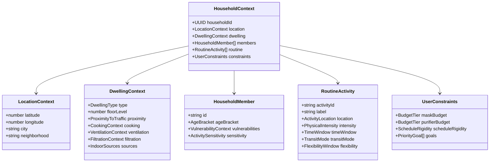

# Dynamic User Context Data Model

> **Document ID:** HS-CTX-001  
> **Status:** Approved Specification  
> **Key Architectural Mandate:** Zero Static Persona Enums. Fully composable, multi-dimensional household and individual context.

---

## 1. Context Architecture & Philosophy

Traditional air quality apps rely on rigid personas (e.g., `"Athlete"`, `"Elderly"`, `"Office Worker"`). This model fundamentally fails the reality of Indian urban life where:
- A single household often spans multiple generations (infants, asthmatic grandparents, working adults).
- Commutes are multi-modal (walking to an e-rickshaw, boarding a metro, then walking through street dust).
- Daily routines vary dynamically based on daylight, heat, and seasonal smog peaks.
- Indoor micro-environments vary dramatically (cooking with LPG vs induction, high-rise 18th floor vs ground-floor street-facing home, presence of air purifiers).

HawaSaathi discards enum archetypes in favor of an **Arbitrary Dynamic Context Model**. Recommendations are derived from specific environmental, physiological, and temporal attributes.



---

## 2. Zod Schema Specification

```typescript
import { z } from "zod";

// ==========================================
// 1. DWELLING & INDOOR MICRO-ENVIRONMENT
// ==========================================

export const CookingFuelSchema = z.enum([
  "LPG",
  "INDUCTION_ELECTRIC",
  "PIPED_NATURAL_GAS",
  "BIOMASS_KEROSENE",
  "MIXED"
]);

export const DwellingContextSchema = z.object({
  dwellingType: z.enum([
    "STANDALONE_HOUSE",
    "APARTMENT_LOW_RISE",   // Floors 1-3
    "APARTMENT_HIGH_RISE",  // Floor 4+
    "INFORMAL_SETTLEMENT"
  ]),
  floorLevel: z.number().int().min(0).max(100),
  proximityToMajorRoadMeters: z.number().int().nonnegative(),
  cooking: z.object({
    primaryFuel: CookingFuelSchema,
    kitchenVentilation: z.enum([
      "DEDICATED_EXHAUST_OUTSIDE",
      "KITCHEN_HOOD_CHIMNEY",
      "OPEN_WINDOW_ONLY",
      "UNVENTED_INDOOR"
    ]),
    averageDailyCookingHours: z.number().min(0).max(12)
  }),
  indoorSources: z.object({
    incenseOrDhoopDaily: z.boolean(),
    mosquitoCoilUsage: z.boolean(),
    indoorSmoking: z.boolean(),
    unventedGasHeater: z.boolean()
  }),
  filtration: z.object({
    hasAirPurifier: z.boolean(),
    purifierLocations: z.array(z.string()).default([]),
    filterType: z.enum(["TRUE_HEPA_H13", "BASIC_FILTER", "DIY_CORSI_ROSENTHAL", "UNKNOWN"]).optional(),
    cleanAirDeliveryRateCadrM3H: z.number().positive().optional()
  }),
  windowSealingQuality: z.enum(["WELL_SEALED", "STANDARD_WINDOWS", "LEAKY_OPEN_SLATS"])
});

// ==========================================
// 2. HOUSEHOLD MEMBERS & VULNERABILITIES
// ==========================================

export const AgeBracketSchema = z.enum([
  "INFANT_0_2",
  "CHILD_3_12",
  "ADOLESCENT_13_17",
  "ADULT_18_59",
  "ELDERLY_60_PLUS"
]);

export const VulnerabilityContextSchema = z.object({
  hasAsthmaOrRespiratoryCondition: z.boolean().default(false),
  hasCardiovascularCondition: z.boolean().default(false),
  isPregnant: z.boolean().default(false),
  hasAllergiesOrSinusitis: z.boolean().default(false),
  notes: z.string().max(280).optional() // Self-described nuance (e.g. "Recovering from pneumonia")
});

export const HouseholdMemberSchema = z.object({
  id: z.string().uuid(),
  nickname: z.string().min(1).max(30),
  ageBracket: AgeBracketSchema,
  vulnerabilities: VulnerabilityContextSchema,
  dailyOutdoorHoursEstimate: z.number().min(0).max(24)
});

// ==========================================
// 3. ROUTINES, COMMUTES & TIME WINDOWS
// ==========================================

export const TransitModeSchema = z.enum([
  "WALKING",
  "BICYCLING",
  "OPEN_AUTO_RICKSHAW",
  "NON_AC_BUS",
  "AC_BUS",
  "METRO_TRAIN",
  "TWO_WHEELER_MOTORBIKE",
  "AC_CAR_CAB",
  "WORK_FROM_HOME"
]);

export const PhysicalIntensitySchema = z.enum([
  "RESTING_SEDENTARY", // Sleeping, sitting, desk work
  "LIGHT",              // Slow walking, shopping, casual standing
  "MODERATE",           // Brisk walk, cleaning, easy cycle
  "VIGOROUS"            // Running, heavy sports, outdoor physical labor
]);

export const TimeWindowSchema = z.object({
  startMinuteOfDay: z.number().int().min(0).max(1439), // 0 = 00:00, 540 = 09:00
  durationMinutes: z.number().int().min(5).max(1440)
});

export const FlexibilityWindowSchema = z.object({
  canShiftEarlierMinutes: z.number().int().min(0).max(180).default(0),
  canShiftLaterMinutes: z.number().int().min(0).max(180).default(0),
  canSubstituteWithIndoorAlternative: z.boolean().default(false),
  canChangeTransitMode: z.boolean().default(false)
});

export const RoutineActivitySchema = z.object({
  activityId: z.string().uuid(),
  label: z.string().min(1).max(60), // e.g. "Morning School Drop", "Brisk Jog", "Construction Site Work"
  memberIds: z.array(z.string().uuid()),
  locationType: z.enum(["INDOOR", "OUTDOOR", "TRANSIT"]),
  physicalIntensity: PhysicalIntensitySchema,
  timeWindow: TimeWindowSchema,
  transitMode: TransitModeSchema.optional(),
  flexibility: FlexibilityWindowSchema
});

// ==========================================
// 4. CONSTRAINTS & PRIORITIES
// ==========================================

export const UserConstraintsSchema = z.object({
  affordabilityTier: z.enum([
    "NO_ADDITIONAL_COST",  // Free actions: window timing, route shifting, wet mopping
    "LOW_COST",            // N95 masks, DIY draft stoppers, salt water gargle
    "MODERATE_TO_HIGH"     // Air purifiers, replacement HEPA filters, AC rides
  ]),
  priorityGoals: z.array(z.enum([
    "PROTECT_VULNERABLE_MEMBER",
    "MAINTAIN_FITNESS_SAFELY",
    "MINIMIZE_COMMUTE_EXPOSURE",
    "OPTIMIZE_INDOOR_AIR",
    "SUSTAINABLE_CHOICES_WHEN_SAFE"
  ])).min(1)
});

// ==========================================
// 5. AGGREGATED HOUSEHOLD CONTEXT SCHEMA
// ==========================================

export const HouseholdContextSchema = z.object({
  householdId: z.string().uuid(),
  updatedAt: z.string().datetime(),
  preferredLanguage: z.enum(["en", "bn", "hi"]).default("en"),
  dwelling: DwellingContextSchema,
  members: z.array(HouseholdMemberSchema).min(1),
  routine: z.array(RoutineActivitySchema),
  constraints: UserConstraintsSchema
});

export type HouseholdContext = z.infer<typeof HouseholdContextSchema>;
export type HouseholdMember = z.infer<typeof HouseholdMemberSchema>;
export type RoutineActivity = z.infer<typeof RoutineActivitySchema>;
```

---

## 3. Context Processing & Rule Synthesis

When this dynamic context is evaluated against live air quality data:

1. **Member Vulnerability Weighting:** An activity involving an infant (`INFANT_0_2`) or a member with asthma (`hasAsthmaOrRespiratoryCondition: true`) immediately triggers stricter exposure thresholds (e.g. outdoor exercise halted at $AQI > 100$ rather than $AQI > 200$).
2. **Transit Exposure Scoring:** Walking or two-wheeler travel during morning inversion peaks ($07:00$–$09:30$) receives high particulate intake risk flags, prompting schedule shift or metro substitution advice.
3. **Indoor Hazard Synthesis:** If the dwelling reports `incenseOrDhoopDaily: true` and `UNVENTED_INDOOR` kitchen, the system flags high indoor particulate concentration and provides practical ventilation timing instead of assuming indoor air is safe.
4. **Economic Feasibility Check:** Recommendations respect `affordabilityTier`. Users selecting `NO_ADDITIONAL_COST` will never be told to "buy a \$300 HEPA purifier"; they are given behavioral and timing strategies (cross-ventilation during wind dispersal windows, wet mopping, shifting morning walk to afternoon).
